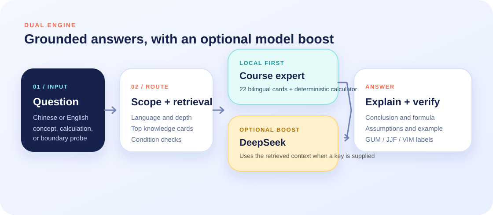
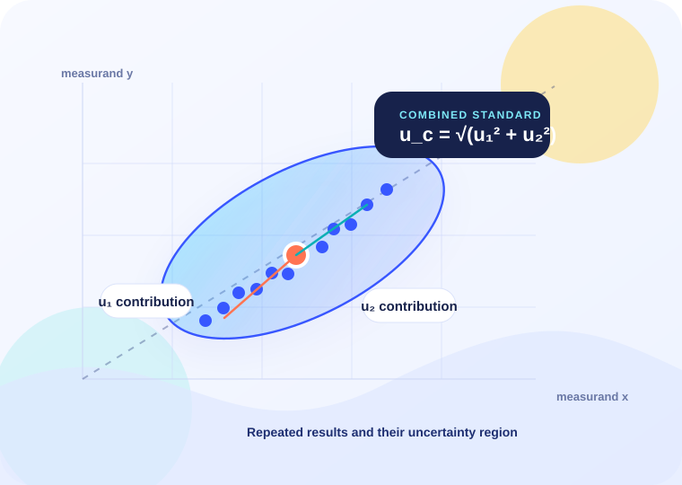

# Error Propagation Lab

A bilingual course assistant for measurement error and uncertainty propagation. The application combines a grounded local knowledge engine with an optional DeepSeek layer, so it remains usable without an API key and becomes more flexible when one is connected.

**Live site:** [https://zhuanght-1201.github.io/error-composition-course-agent/](https://zhuanght-1201.github.io/error-composition-course-agent/)



## What it does

- Answers questions in Simplified Chinese or English with a single-click language switch.
- Covers 22 structured knowledge cards on measurement error, Type A/B evaluation, sensitivity coefficients, correlation, uncertainty budgets, degrees of freedom, outliers, and nonlinear propagation.
- Produces three levels of detail: one-sentence, standard, and detailed explanations.
- Labels answers with their GUM, JJF 1059.1, or VIM grounding.
- Rejects out-of-scope questions and asks for missing models, units, correlation information, or coverage assumptions.
- Includes four deterministic calculators:

  | Tool | Input | Output |
  | --- | --- | --- |
  | Independent root sum square | Standard uncertainty components | Combined standard uncertainty |
  | Correlated pair | Two components and correlation coefficient | Combined uncertainty with covariance |
  | Repeated mean | Single-reading standard deviation and sample count | Standard uncertainty of the mean |
  | Expanded uncertainty | Combined standard uncertainty and coverage factor | Expanded uncertainty |

- Optionally routes eligible questions through DeepSeek with locally retrieved course context.
- Automatically falls back to the local engine if the API request fails.

## How the dual engine works



Every question first passes through the same local route:

1. Normalize the question and detect the requested level of detail.
2. Check whether the question belongs to the measurement-uncertainty scope.
3. Retrieve the most relevant bilingual knowledge cards.
4. Run a deterministic calculation when the question matches a supported numerical pattern.
5. Build an answer from the selected card, formula, example, conditions, and references.

When DeepSeek is enabled, the application sends the selected knowledge cards and the local draft as context. The model can improve explanation and follow-up handling, while the app keeps local source labels and numerical checks in view. API failures never block the local path.

## Use locally

No build step is required.

```powershell
cd agent-site
python -m http.server 8080
```

Then open `http://localhost:8080`.

Opening `index.html` directly also works for the local engine. A local HTTP server is more reliable when testing session storage and browser API permissions.

## Connect DeepSeek

1. Open **API and engine settings** from the header or the blue recommendation banner.
2. Select **DeepSeek (recommended)**.
3. Keep the default endpoint: `https://api.deepseek.com/chat/completions`.
4. Choose `deepseek-chat` for the recommended balance of quality and speed, or enter `deepseek-reasoner`.
5. Enter your own API key and enable the API switch.
6. Use **Test connection** to verify the endpoint, then save the settings.

Create a key in the [DeepSeek API platform](https://platform.deepseek.com/api_keys).

### Key handling

- The key is stored only in the current tab's `sessionStorage`.
- Closing the tab clears the saved key.
- The key is never included in this repository or in static files.
- Requests go directly from the browser to the selected endpoint.
- Use a personal key with an appropriate spending limit. Avoid shared or institutional keys.

The DeepSeek endpoint currently allows browser CORS requests from the GitHub Pages origin. Custom OpenAI-compatible endpoints must also allow browser requests from the deployed origin.

## Project structure

```text
agent-site/
├── index.html                 # Bilingual interface and settings dialog
├── styles.css                # Responsive visual system
├── app.js                    # UI, bilingual state, API client, API fallback
├── core.js                   # Retrieval, local answers, formulas, API context
├── knowledge.js              # 22 bilingual knowledge cards and references
├── assets/
│   ├── architecture.svg      # Dual-engine architecture illustration
│   └── uncertainty-map.svg   # Measurement uncertainty illustration
└── tests/
    ├── core.test.js           # Knowledge, calculation, and prompt-context tests
    └── ui.test.js             # Desktop/mobile, language, settings, and API tests
```

## Tests

```powershell
node tests/core.test.js
```

The UI test uses Playwright and intercepts the DeepSeek request, so it does not consume an API key or send data externally.

```powershell
$env:NODE_PATH="<path-to-node_modules>"
node tests/ui.test.js qa
```

The UI suite verifies:

- Local and English answer paths.
- Desktop and mobile layouts.
- Language switching.
- All calculator entry points.
- The DeepSeek settings dialog.
- Request payload construction.
- Successful API-rendered responses.
- Automatic local fallback after an API failure.

## Knowledge scope

The assistant focuses on measurement error, measurement uncertainty, uncertainty evaluation, and propagation. It does not attempt open-domain questions or replace a complete metrology review. Complex nonlinear models, limited degrees of freedom, and strongly correlated budgets require additional information and engineering judgment.

## References

- JCGM 100:2008, *Evaluation of measurement data - Guide to the expression of uncertainty in measurement*.
- JJF 1059.1-2012, *Evaluation and Expression of Uncertainty in Measurement*.
- JCGM 200:2012, *International Vocabulary of Metrology*.
